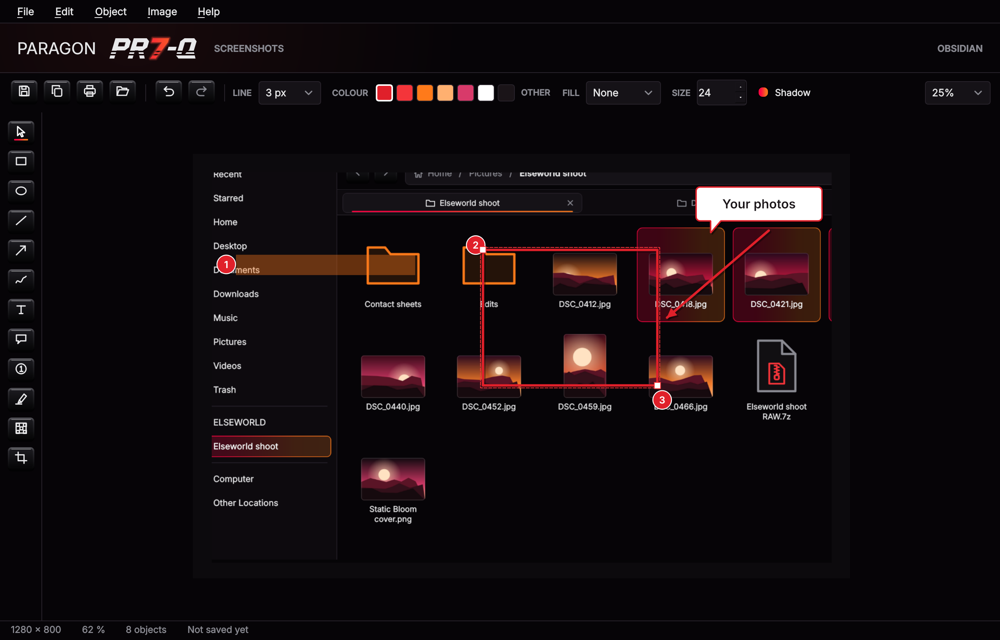

# Paragon PR7-Q

A screenshot tool for Windows 10/11 that works the way **Greenshot** works, in the Paragon family look (PR7-Z,
PR7-W, PR7-L, PR7-F, PR7-E, PR7-R, PR7-P, PR7-M). Python and PySide6.



## What it does

- **Lives in the notification area.** The keys work from any program:

  | Key | Capture |
  |---|---|
  | Print | a region (drag), or a window (click) |
  | Shift+Print | the last region again |
  | Alt+Print | the window under the pointer |
  | Ctrl+Print | the full screen (all screens, or the one with the pointer) |

  Change them in Preferences. Windows 11's Snipping Tool can hold Print: PR7-Q says so and you can turn that off in
  Windows' Settings > Accessibility > Keyboard, or choose another key.
- **Capture region:** the frozen screen, dimmed except the chosen part, with guides, the size and a magnifier
  (position and colour). Enter takes the whole screen, Esc or a right click cancels, the arrow keys move one pixel.
- **After a capture** (Preferences): ask with a menu, save directly, Save as, copy, open the editor, open in PR7-P, print.
  File names from a pattern (`Screenshot %Y-%m-%d %H.%M.%S`, `{title}` = the window's title); never overwrites.
- **The editor:** rectangle, ellipse, line, arrow, freehand, text, speech bubble, step numbers, highlighter,
  pixelate, crop; select / move / resize / restyle; line width, colour, fill, shadow; undo / redo; canvas size;
  save, copy, print, open in PR7-P.
- Options: delay, mouse pointer, PNG / JPEG / BMP, JPEG quality, start with Windows, updates.

## Command line

```
PR7-Q.exe [--region | --window | --full | --last-region]   capture (in the running PR7-Q if there is one)
PR7-Q.exe --tray                                            start quietly in the notification area
PR7-Q.exe --startup on|off                                  start with Windows or not
PR7-Q.exe --selftest OUT.json                               the install check CI runs
```

## Building

`pip install -r requirements-dev.txt`, `python -m pytest`, `pyinstaller pr7q.spec`, then Inno Setup 6 on
`installer/pr7q.iss`. CI does all of it on Windows.
